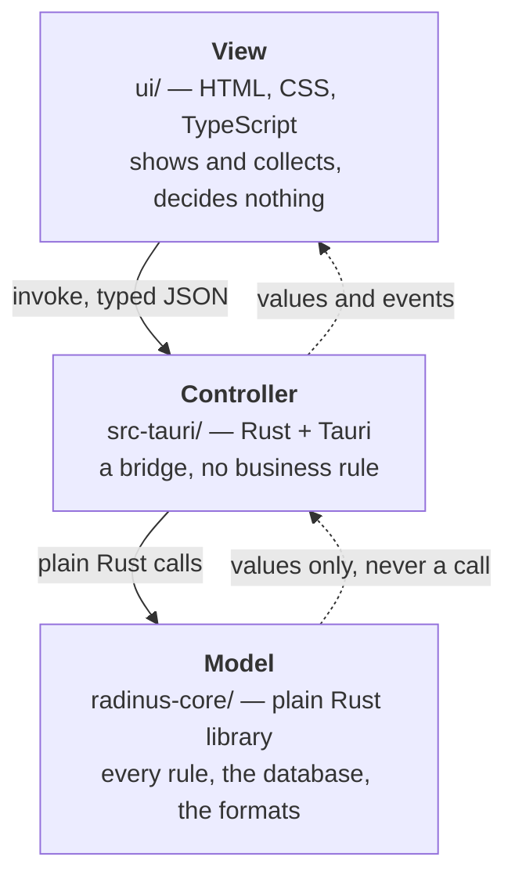
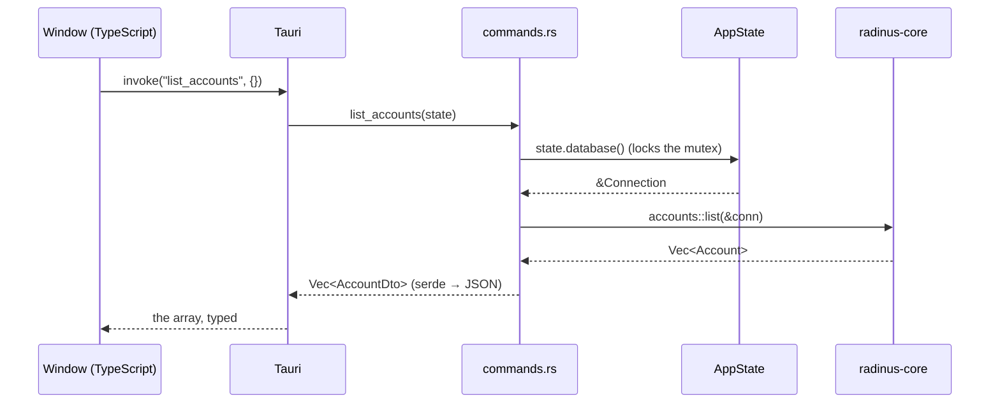
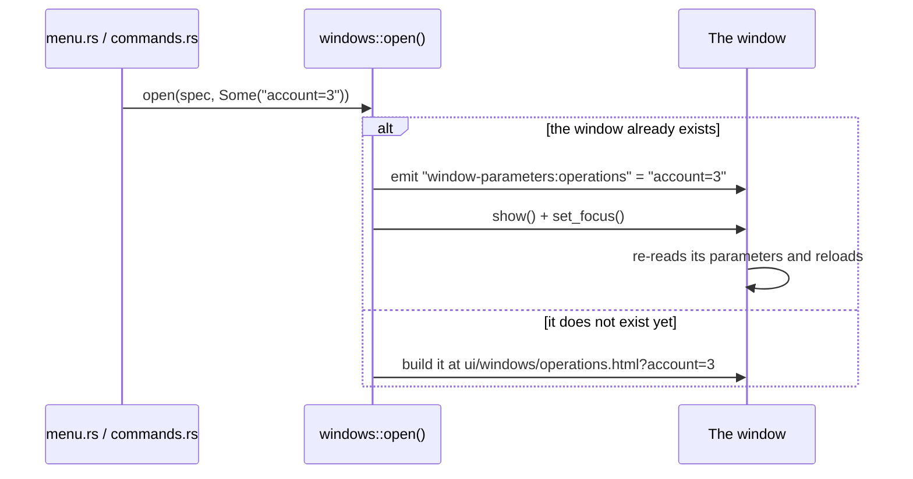
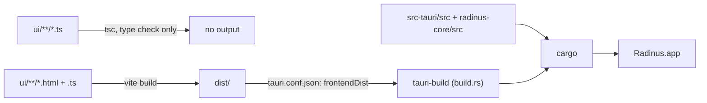
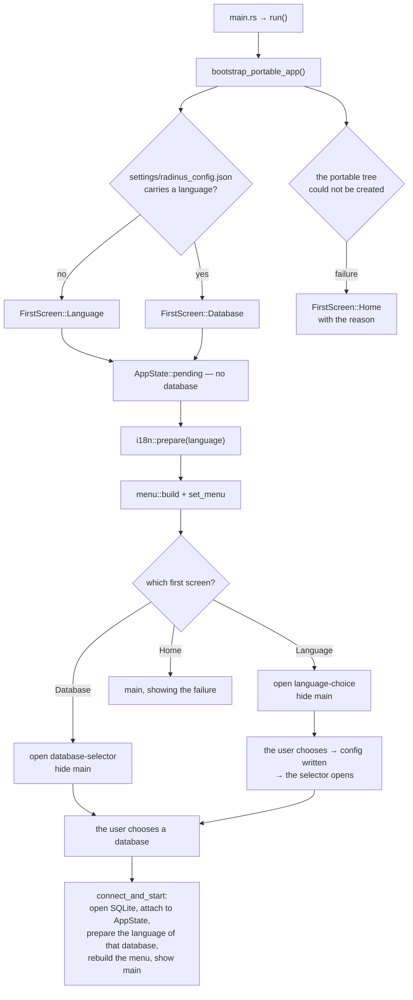

# The architecture of Radinus 2.0.0

This document is written for whoever has to understand and maintain Radinus —
its author six months from now included. It says how the application is put
together, what every source file is for, how Tauri and Rust meet, and where to
put a new thing so it lands in the right layer.

Radinus 2.0.0 is a rewrite of Radinus 1.9.3, a Windows application written in
WinDev by the same author. The original is the specification: its windows, its
rules and its file formats are reproduced, and the code often names the WinDev
procedure it was ported from. When this document says *the original*, that is
what it means.

---

## 1. Three layers, and one direction



Dependencies run **one way only**. The core knows nothing of Tauri, of a
window or of the disk layout; it compiles and is tested on its own, and could
be driven by a command-line tool tomorrow without a line changing. The
controller knows Tauri and the core; the view knows neither Rust nor SQL.

This is the Model–View–Controller idea, with one difference worth naming:
**the controller holds no logic at all.** In a classic MVC the controller
decides; here it translates. A command takes a JSON call, calls one core
function, and forwards what comes back. When you find yourself writing an
`if` in `commands.rs` that decides something about money, dates or accounts,
it belongs in the core.

The rule is not decoration. It is what makes 26 500 lines of business rules
testable without launching an application, and what will let Radinus grow a
second face — a command line, a web server — without rewriting its heart.

---

## 2. The folder layout

```
Radinus-2/
├── Cargo.toml               workspace: radinus-core + src-tauri
├── package.json             frontend deps, npm scripts
├── vite.config.ts           one entry per window page
├── tsconfig.json
├── index.html               the home window (F01)
│
├── radinus-core/            ── THE MODEL ──
│   ├── Cargo.toml
│   ├── i18n/                fr.ftl, en.ftl, es.ftl — every sentence
│   ├── src/                 38 modules, no framework
│   └── tests/               integration tests (5 files)
│
├── src-tauri/               ── THE CONTROLLER ──
│   ├── Cargo.toml
│   ├── tauri.conf.json      product name, version, the "main" window
│   ├── build.rs             tauri-build, run at compile time
│   ├── capabilities/        which window may talk to Rust
│   ├── icons/
│   └── src/                 10 modules
│
├── ui/                      ── THE VIEW ──
│   ├── main.ts              the home window's script
│   ├── styles.css           the home window's style
│   ├── tokens.css           the measured colours of the charter
│   ├── assets/              icons, banner
│   ├── windows/             one .html + one .ts per window, plus shared parts
│   └── tests/               windows.test.mjs, driven by a real browser engine
│
└── docs/                    this document, and About_dependencies.md
```

Three folders never enter the repository, and `.gitignore` keeps them out:
`target/`, `node_modules/`, `dist/`, and — this one matters —
`radinus-core/tests/fixtures/`, which holds the author's real financial data.

---

## 3. The Model — `radinus-core`

An ordinary Rust library. Every module below holds business rules and their
tests in the same file: a rule and its proof travel together.

### The foundations

| File | What it is for |
|---|---|
| `lib.rs` | The list of modules, and the documentation of the layer. |
| `domain.rs` | The entities mirroring the tables: `Account`, `Operation`, `Cheque`… Field names are English; the SQL columns they map to are French. |
| `money.rs` | Turning an `i64` micro-unit amount into the string a human reads, with the separators of the current language, and reading one back. |
| `text.rs` | Ordering French labels the way the original does — the rule was *measured* on real data, not guessed. |
| `i18n.rs` | The whole translation system: the `Language` type, the WinDev language numbers, the Fluent bundles, and reading/writing the language a database runs in. |
| `location.rs` | **Where Radinus keeps its things.** Deciding between the installed and the portable mode by reading `settings/start_mode.toml` beside the executable, creating `settings/ databases/ backups/ logs/` in the folder it chose, reading and writing `radinus_config.json`, listing the databases and their `radinus_base.json`. Called `portable.rs` until 05/08/2026, when the installed mode made that name false (`Decisions.md`, P-36). |

### The database

| File | What it is for |
|---|---|
| `database/mod.rs` | Opening and creating a database, and the errors that can come out. |
| `database/schema.rs` | The **declaration** of the 22 tables plus `Parametres`, and the procedure that brings any database up to it — missing tables, missing columns, missing indexes — on every single open. It is a declaration, not a history: there is no numbered list of migrations. Read `Schema_evolution.md` before touching it. |
| `database/seed.rs` | The reference data inserted into a brand-new database — banks, account types, categories, cheque statuses — and the "reset to blank". Also the three *frozen* nomenclatures that `schema.rs` refills when it finds them empty. |
| `database/lock.rs` | The **password of a database**. SQLCipher encrypts the file's pages in AES-256; this module gives a connection its key, tells whether the file can be read at all, and moves a database between the encrypted and the plain world (`Decisions.md`, P-34). |
| `database/keygen.rs` | `max(id) + 1`, reproducing WinDev's `Genere_Clef()`. **No SQL auto-increment anywhere**, because a restored 1.9.3 backup carries its own ids. |

### The rules

| File | What it is for |
|---|---|
| `accounts.rs` | Bank accounts: the three carried-over balances, statistics, deleting every operation of an account. |
| `operations.rs` | The operations of an account, read between two dates. **The list is a tree**: a mother and her daughters, and that is where the traps are. |
| `sub_operations.rs` | Splitting one operation into several, and the "Complément" that always closes the split — recognised by a marker, never by its label. |
| `balances.rs` | The three balances (bank, real, final) and the running balance of each line. Ported from the author's own WinDev source. |
| `nomenclatures.rs` | The seven editable lists — categories, assignments, payment modes, payees, projects, budget lines, banks — and the two rules that govern them all. |
| `cheques.rs`, `chequebooks.rs` | Cheques, chequebooks, and the cheque↔operation link. |
| `operation_templates.rs` | Ready-made entries: a template is a filled-in form waiting to be used. |
| `recurring_operations.rs` | Recurring rules, the calendar they would produce, and the insertion of that calendar. |
| `budget.rs` | The budget: entering it, and checking whether it was kept — two doors, two questions. |
| `transfers.rs` | Moving an amount between two accounts: one gesture, two operations. |
| `statistics.rs` | The cross-tabulated matrix, on seven axes — six nomenclatures and the verification. |
| `dashboard.rs` | The dashboard. |
| `balance_curve.rs` | The balance, day by day. |
| `quick_classification.rs` | Classifying many operations at once, over a draft held in memory until it is saved. |
| `attachments.rs` | Files attached to an operation. **A file never carries its own name on disk**: it is stored under a GUID. |
| `journal.rs` | The report of the last technical operation — and of that one only, like the original, which empties its log at the start of each. |
| `repair.rs` | Repairing and compacting the database. It writes and it erases; it is not a read-only check. |

### The formats — reading and writing the outside world

| File | What it is for |
|---|---|
| `backup/mod.rs` | Reading a Radinus 1.9.3 archive and restoring it whole. |
| `backup/records.rs` | The JSON shape of each table in that archive. Field names are French here, matching the original schema exactly. |
| `backup/writer.rs` | Writing an archive in the exact same format — down to the empty entry 1.9.3 puts in every one of them. |
| `ofx_import.rs` | Reading an OFX bank statement, ported from the author's `Ofx_Import` class. |
| `statements.rs` | What is done with a statement once read: matching against what the database already knows, and integrating a line. |
| `csv_statement.rs` | A statement in CSV, and the window that cuts it into columns. |
| `qif_import.rs` | Reading a QIF bank statement into the same `Statement` as OFX (P-73). |
| `csv_excel_import.rs` | The three-step Excel import: capture zone, field mapping, policies. |
| `exports.rs` | The two banking outputs of the export menu: OFX and QIF. |
| `sheets.rs` | One sheet, three ways to write it — Excel, OpenDocument, CSV/XML/JSON. Written once for every table in the application. |
| `printing.rs` | Composing printouts and reports with Typst, and producing the PDF. **Radinus builds its own PDF** so the same document comes out of all three operating systems. |

---

## 4. The Controller — `src-tauri`

Ten files, and the whole point of them is to carry things across the bridge
without touching them.

| File | What it is for |
|---|---|
| `main.rs` | Six lines: it calls `radinus_lib::run()`. |
| `lib.rs` | The **startup**, and the registration of every command. See §7. |
| `state.rs` | `AppState`: the open database behind a mutex, the attachments folder, the portable root, and the drafts held in memory (quick classification, statement import, Excel import, proposed calendar, journal, what each form is holding). |
| `commands.rs` | The 200-odd IPC commands. The largest file of the layer, and the flattest: each command is a handful of lines. |
| `windows.rs` | One function per window, returning its label, its page, its title, its size and its parent. Also `open()`, which reuses a window rather than building a second one. |
| `menu.rs` | The native menu bar, built entirely from Fluent keys, and rebuilt whole when the language changes. |
| `texts.rs` | The dictionary a window receives: the curated list of every key a window may ask for. |
| `database_operations.rs` | Backup, restore, repair, delete-all — the menu entries that talk to files rather than opening a window. Each runs on its own thread. |
| `system.rs` | The very little Radinus asks of the operating system: opening a file with the default application, sending a file to the trash, making a filename safe on all three systems. |
| `crossings.rs` | The crossing tests. See §11. |

---

## 5. The View — `ui`

One `.html` and one `.ts` per window, plus a handful of shared pieces. No
framework: plain HTML, CSS and TypeScript.

### The shared pieces — read these first

| File | What it is for |
|---|---|
| `windows/table.ts` | The table every list window is built on: columns, sorting, per-column funnel filters, multiple selection, virtualised rows, right-click export. |
| `windows/texts.ts` | The window's words. `loadTexts()` fetches the whole dictionary once before anything is drawn, `t(key)` reads it, and `onLanguageChanged()` re-dresses the window when the language changes. |
| `windows/dialog.ts` | The application's own dialogs: yes/no, ask for a word, ask for an amount, tell. Radinus never uses the browser's `alert` or `confirm`. |
| `windows/window-frame.ts` | Leaving a window — which **hides** it, and never destroys it. |
| `windows/money-field.ts` | A field that holds money and nothing else: it filters what is typed and formats on exit, with the separators the core gave. |
| `windows/export.ts` | The right-click export shared by every table. |
| `windows/period.ts` | The Période menu and the dates it computes. |
| `windows/printers.ts` | Choosing a printer, shared by every window that prints. |
| `windows/nomenclature.ts` | Which of the seven nomenclatures a window is working on. |
| `main.ts` | The home window's script. |

### The windows

Each pair `<name>.html` + `<name>.ts` is one window of the original, and the
comment at the top of the `.ts` names it — `F02`, `F08`, `F20`. Two pairs
serve seven windows each (`nomenclature-list`, `nomenclature-form`), because
the seven nomenclatures share one template and are told which one they are
working on through their address. Likewise `statistics.html` serves the six
statistics, and `budget.html` the two budget doors.

Two windows have no `F` number, because the original had nothing like them:

- `language-choice` — the language list at the very first launch. **It uses no
  sentence at all**: each line is the name of a language written in that
  language, which is understood before anyone knows what the user speaks.
- `database-selector` — the database manager, shown at every launch.

---

## 6. How Tauri is used

Tauri gives Radinus four things and no more: a native window holding a
webview, a typed bridge between JavaScript and Rust, the system menu bar, and
a build that packages the whole into an application. Everything else is ours.

### 6.1 The bridge — a command, end to end

A command is an ordinary Rust function with an attribute. The window calls it
by name, with a JSON object; Tauri finds it, converts the arguments, runs it,
and sends back what it returns — or its error.



Three things to notice, because each was a decision:

1. **The command takes `State<'_, AppState>`.** Tauri hands it in; it is the
   only way to reach the open database. `state.database()` returns a guard
   over a mutex, and every command is short so the lock is never held long.
2. **A command never returns a core type directly.** It returns a `Dto`
   struct, declared next to it, that says exactly what the window receives.
   The two ends are two languages and nothing links them but a string.
3. **Errors come back as `Result<T, String>`**, and the string is already
   translated, because only the core knows the language the database runs in.

The registration lives in `lib.rs`:

```rust
.invoke_handler(tauri::generate_handler![
    commands::ping,
    commands::list_accounts,
    // … around two hundred more
])
```

A command missing from that list exists in Rust and cannot be called. That is
exactly the kind of gap a compiler cannot see, so a crossing test checks the
two lists against each other (§11).

### 6.2 The windows

Radinus does **not** use one window with a router inside. Each window of the
original is a real system window with its own HTML page, as on the original —
the author's decision, and it is what makes them independent, movable and
individually closable.

`windows.rs` holds one function per window, returning a `WindowSpec`:

```rust
pub fn balances_window(language: Language) -> WindowSpec {
    WindowSpec {
        label: "balances".to_string(),          // Tauri's identity for it
        url: "ui/windows/balances.html".to_string(),
        title: i18n::text(language, "window-balances-title"),
        width: 820.0,
        height: 620.0,
        closable: false,          // a Radinus window is left by its door
        resizable_chrome: true,
        parent: None,
    }
}
```

Two of those fields are rules rather than settings:

- **`closable: false`.** The system's close button is disabled everywhere. A
  Radinus window is left through its door, as in the original, and that leaves
  one exit to guard instead of two — no unsaved work slips out the side.
- **`parent`.** A form declares its list as its parent, so it stays above it
  and goes away with it. The relation is one-way: closing the form leaves the
  list open.

### 6.3 A window is built once and never destroyed

This is the single most important rule of the view layer, and three separate
faults were paid to learn it.

Leaving a window **hides** it. Asking for it again **shows** it. It is never
destroyed and never rebuilt — rebuilding one under a label that was still
being torn down crashed the application, and a list asked for again a moment
after closing came back as a dead grey panel.

The consequence: **a window that comes back does not reload its page.** Its
script ran once, long ago. New parameters therefore reach it as an event:



The event name carries the window's label — `window-parameters:operations` —
because a JavaScript `listen()` receives every `emit_to`, addressed or not.
Without the label in the name, every window would hear every other window's
parameters.

A crossing test checks that every window able to receive parameters listens
for them. Three windows are excused, by name, in that test.

A late corollary, learned on 02/08/2026: **a window created invisible comes up
blank.** It has never been painted. Windows that must not show at startup are
built visible and hidden immediately after.

### 6.4 Permissions — `capabilities/default.json`

Tauri only lets a window talk to Rust if its label is listed there. A window
missing from that file is not a window with fewer rights; it is a window that
cannot say anything at all — not even that it wants to close. Patterns are
allowed (`*-list`, `*-form`, `statistics-*`), which is how the seven
nomenclatures and the six statistics are covered in three lines.

The file also grants exactly one thing beyond the default: `dialog:allow-save`
— the system's "save as" box. **Reading a file is never granted.** The window
asks where to write, and Rust writes there.

Here too, a compiler reads nothing: a crossing test reads that JSON and checks
every window declared in `windows.rs` against it.

### 6.5 The menu

The menu bar is native and built in Rust, in `menu.rs`. Every label comes from
a Fluent key; not one is written in that file. Entries whose window does not
exist yet are built disabled rather than omitted, so the shape of the
application is visible from the first day.

Clicking an entry fires `on_event`, which routes on the entry's id. Ids that
carry data encode it in the string — `nomenclature:category`,
`settings-language:7`, `statistics-by:payee` — so adding a nomenclature, a
language or a statistic adds no branch.

**The menu is rebuilt whole when the language changes**: a menu entry cannot
be renamed in place on macOS.

### 6.6 Events

Three kinds travel from Rust to the windows, and they are all one-way:

| Event | Sent when | Heard by |
|---|---|---|
| `window-parameters:<label>` | a window is reopened with new parameters | that window |
| `language-changed` | the language changed | every open window, which re-dresses itself |
| the data events (`accounts-changed`, `operations-changed`, …) | something was written | the lists showing it, which reload |

### 6.7 The build



`vite.config.ts` lists **one entry per window page**. A page missing from that
list is not built, and the window opens on a 404 — which is why a crossing
test checks that list against `windows.rs` too.

In development, `npm run tauri dev` starts Vite on `localhost:1420` and Tauri
points the webviews at it: a changed window reloads without recompiling any
Rust.

---

## 7. Startup, step by step

The startup is where the layers meet, and it changed on 02/08/2026: Radinus
opens no database on its own any more.



Two points worth keeping in mind:

- **The dictionary is prepared during startup**, not in front of the first
  window. Parsing a language file costs a few milliseconds; they are spent
  where the user is already waiting.
- **`app.restart()` is not used anywhere.** It was, and the relaunched process
  painted blank windows and then died without a word in the terminal. What it
  was there for — changing database while one is open — is now refused
  outright: the selector greys its open button and says to quit and start
  again.

---

## 8. Where every sentence lives

```
radinus-core/i18n/fr.ftl ─┐
radinus-core/i18n/en.ftl ─┼→ i18n.rs (Fluent bundles, one per language,
radinus-core/i18n/es.ftl ─┘   built once and never modified)
                                        │
                                        ▼
                          texts.rs — the curated key list
                                        │
                       invoke("ui_texts") once, before drawing
                                        │
                                        ▼
                          texts.ts — the window's dictionary
                                        │
                                     t("key")
```

Four rules hold this together:

1. **No window holds a sentence of its own.** Not a title, not a button, not
   an error.
2. **An unknown key comes back as the key itself.** A missing translation must
   be visible on screen, not silently empty.
3. **The dictionary carries whole sentences only.** A sentence with a hole in
   it — "34 lines classified" — is resolved by the core, because only Fluent
   knows whether the number changes the sentence.
4. **The language a database runs in is stored as its WinDev number** — 5
   French, 3 English, 7 Spanish — because a 1.9.3 backup carries that number
   and giving it back unchanged is the only way a round trip loses nothing.

Adding a language is one line in `i18n.rs` and one `.ftl` file beside it. The
menu, the selector and the first-launch list all read `Language::all()`.

---

## 9. Data, and the decisions embedded in it

- **Amounts are `i64` micro-units** — the value times 1 000 000. No float ever
  touches money.
- **Keys are `max(id) + 1`**, computed by `keygen.rs`, never by SQL. A
  restored 1.9.3 backup brings its own ids.
- **Table and column names are the original French names, verbatim.** They are
  not translated, not tidied, not pluralised. A backup restored into a renamed
  schema is a backup lost.
- **The operation list is a tree.** A mother, her daughters, and a "Complément"
  that closes the split — recognised by a marker, never by its label.
- **Three balances**, and they are cumulative: bank is the pointed one, real
  adds the committed, final adds the planned.
- **The schema has its own version line**, `Parametres.VerDataBase`,
  continuing the numbering of Radinus 1.x. Opening a database migrates it
  forward; nothing migrates backward.

---

## 10. The portable folder

Everything the application needs sits next to the executable:

```
Radinus/
├── Radinus.app (or radinus.exe)
├── settings/
│   └── radinus_config.json      language, last opened database, recents
├── databases/
│   ├── Radinus_00001/
│   │   ├── radinus.sqlite       always this name
│   │   ├── radinus_base.json    label, comment, where it came from
│   │   └── attachments/         this database's attachments, and no other's
│   └── Radinus_00002/
├── backups/
└── logs/
```

Two rules make it tolerant of a user who moves things around:

- **a database is any folder holding a `radinus.sqlite`**, whatever the folder
  is called. Renaming `Radinus_00001` to `MesComptes` outside the software
  changes nothing;
- **numbering only counts folders named `Radinus_NNNNN`**. The next one
  created follows the highest of those; anything else is ignored.

`radinus_base.json` is **indicative**. It describes where a database came
from, nothing in the software depends on it, and it is regenerated with the
folder name when it is missing.

---

## 11. How Radinus is tested

Four kinds, and the third is the one worth explaining.

**Unit tests**, in the same file as the rule they prove — the usual Rust way.
Around 380 of them in the core.

**Integration tests**, in `radinus-core/tests/`: a full backup round trip, the
balances against the author's real figures, a real OFX file, the messages a
statement import produces. Those reading the author's real data print a notice
and pass when the fixture is absent.

**The crossings**, in `src-tauri/src/crossings.rs`. They test no function.
Each one holds the two ends of a seam that nothing else links, and reads the
files on both sides — including the ones that are not Rust:

| Crossing | What it holds together |
|---|---|
| caller ↔ callee | every `invoke("…")` in TypeScript against `generate_handler!` — in both directions |
| requester ↔ counter | every `t("…")` against the dictionary `texts.rs` serves |
| sender ↔ receiver | every window that can be reopened against the `window-parameters:` it listens for |
| window ↔ permission | every `WindowSpec` against `capabilities/default.json` |
| window ↔ bundler | every page a window asks for against `vite.config.ts` |
| window ↔ repository | every image an HTML page asks for against `ui/assets/` |
| menu ↔ handler | every menu id built against the code that listens for it |
| and a dozen more | frozen fields, import policies, export formats, print labels |

The principle is the author's, given after 519 checks let two faults through
that he found in a minute:

> The best tests are the ones that cross the data, or the ones at the two ends
> of the problem — input/output, caller/callee, sender/receiver. The truth
> often appears where the logics meet.

Every crossing carries, in its comment, the fault that caused it. Read that
comment before changing one.

**The window tests**, in `ui/tests/windows.test.mjs`: a real browser engine
opens every page with the Tauri bridge replaced by a stub, clicks the buttons
and checks what appears. They exist because a whole delivery once went out
with windows that looked perfect and did nothing — the Rust was tested, the
interface was not tested at all.

```bash
npm run build                              # tsc, then vite
cargo test --workspace                     # core + crossings
cargo clippy --workspace --all-targets
npm run test:ui                            # the browser tests
```

---

## 12. Adding something — where it goes

**A new business rule.** In `radinus-core`, in the module of the thing it is
about, with its tests beside it. Nowhere else. If the controller needs an
`if`, the rule is in the wrong place.

**A new window.**

1. the rule in the core, if it needs one;
2. the commands in `commands.rs`, registered in `lib.rs`;
3. a `WindowSpec` in `windows.rs`, and the label in
   `capabilities/default.json`;
4. the page in `ui/windows/`, and its entry in `vite.config.ts`;
5. its keys in the three `.ftl` files, and in `texts.rs`;
6. `listen("window-parameters:<label>")` in its script, unless it never
   receives any — and then say so in the crossing test.

Run `cargo test -p radinus --lib`: the crossings will name whichever of those
six steps you forgot.

**A new sentence.** In the three `.ftl` files, and in `texts.rs` if a window
asks for it directly. Never in a `.ts` file.

**A new language.** One line in the `KNOWN` table of `i18n.rs`, one `.ftl`
file beside the others. Nothing else in the whole application.

**A new dependency.** Ask the author. See `About_dependencies.md`.
