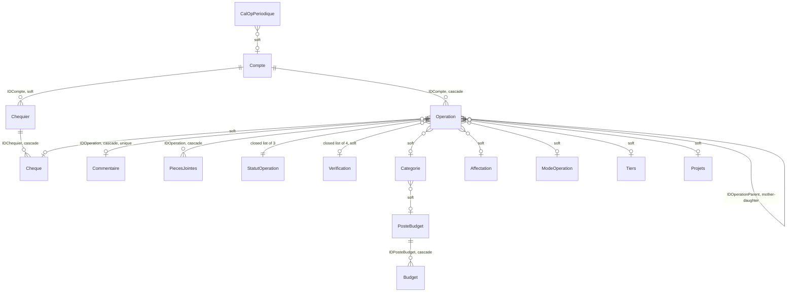

# The data model of Radinus

Twenty-one tables in one SQLite file, plus the two JSON files that live beside
it. This document says what each table holds, what links them, and the half
dozen rules that are not visible in the DDL and that will bite whoever ignores
them.

**Every table and column name is the original French name of Radinus 1.9.3,
verbatim.** They are not translated and never will be: a backup restored into
a renamed schema is a backup lost. See `Glossary.md` for the French-to-English
bridge.

The whole schema is created by `radinus-core/src/database/schema.rs`, prefilled
by `seed.rs`, and its keys are generated by `keygen.rs`.

---

## 1. Six rules before the tables

**1 · Amounts are `i64` micro-units.** The value times 1 000 000: 12,34 € is
stored as `12_340_000`. Every column named `Montant`, `Solde*` or `Report*`
holds one. No floating point ever touches money.

**2 · Keys are `max(id) + 1`, computed in Rust.** `database/keygen.rs`
reproduces the original's `Genere_Clef()`. **No column is `AUTOINCREMENT`**,
because a restored 1.9.3 backup brings its own ids and an auto-increment would
fight them. Every insert goes through `next_id` first, restores included.

**3 · Dates are TEXT in ISO-8601**, `AAAA-MM-JJ`. `Operation.Date` and
`DatePointage` are **nullable**, and that is deliberate: an old backup may not
carry them, and a restore must never be refused over an absent field.

**4 · Soft links.** Most nomenclature links are declared `INTEGER NOT NULL
DEFAULT 0` with **no** `REFERENCES` clause. `0` means "not specified". An
operation with no category is perfectly normal, and deleting a category must
not take operations with it. Where a real `REFERENCES … ON DELETE CASCADE`
appears, it is meant: read it as "this record cannot exist without its
parent".

**5 · Booleans are integers**, `0` or `1` — `EstParent`, `EstComplement`,
`CompteCloture`.

**6 · The schema has its own version line.** `Parametres.VerDataBase` mirrors
`PRAGMA user_version` and continues the numbering Radinus 1.x walked from 0
to 9. It is **11** today. Opening a database migrates it forward; nothing
migrates backward.

---

## 2. The shape of it



Read it as three circles. **The account and its operations** in the middle,
with the cheques beside them. **The seven nomenclatures** around, linked
softly. **The budget and the recurring rules** apart, each with its own life.

---

## 3. The account — `Compte`

One row per bank account. It is the only table that carries balances, and it
carries six of them: three **carried over** and three **current**.

| Column | Type | What it holds |
|---|---|---|
| `IDCompte` | INTEGER PK | |
| `Libelle` | TEXT | The name the user gave it — "CCP", "Livret A". |
| `ReportPointe` / `ReportEngage` / `ReportPrevu` | INTEGER | What the account held **before** the first operation Radinus knows about, one per status. Setting `ReportPointe` right is what makes the bank balance match the bank. |
| `SoldeBanque` / `SoldeReel` / `SoldeFinal` | INTEGER | The three current balances, **cumulative**: bank = pointed; real = pointed + committed; final = the three. Recomputed whole, never patched. |
| `IDTypeCompte`, `IDBanques` | INTEGER | Soft links: account type, bank. |
| `NomTitulaire`, `AdresseTitulaire`, `AdresseAgenceBank` | TEXT | Holder and branch, for the printed bank details. |
| `COBCodeBanque`, `COBCodeGuichet`, `COBNumCompte`, `COBClefRIB`, `COBIBAN`, `COBBIC` | TEXT | The bank details. The `COB` prefix comes from the original. |
| `DateOuverture`, `DateCloture` | TEXT | Opened, closed. |
| `CompteCloture` | INTEGER | `1` when closed. **A closed account is left out of the balances window and out of its total** — adding it would say the household owns money it closed years ago. |
| `NumProchCheque` | INTEGER | The next cheque number. |
| `Devise` | TEXT | `'EUR'`. One currency per account; no conversion anywhere. |

**The three balances are recomputed, never adjusted**, by `balances.rs` —
ports of the original's `Maj_SoldeBanque`, `Maj_SoldeReel` and `Maj_SoldeFinal`.
Anything that moves money runs them again in full.

---

## 4. The operation — `Operation`

The largest table, and the one whose shape holds the traps.

| Column | Type | What it holds |
|---|---|---|
| `IDOperation` | INTEGER PK | |
| `Libelle` | TEXT | |
| `Date` | TEXT, nullable | The day it happened. |
| `DatePointage` | TEXT, nullable | The day the bank processed it — **not** the same day. |
| `Montant` | INTEGER | Micro-units. **Negative is a debit, positive a credit.** One column, one sign, never two columns. |
| `IDCompte` | INTEGER | `REFERENCES Compte ON DELETE CASCADE` — deleting an account takes its operations with it. |
| `IDStatutOperation` | INTEGER | `REFERENCES StatutOperation`. **1 pointed, 2 committed, 3 planned**, and the list is closed. |
| `IDVerification` | INTEGER, default 2 | **Schema 11.** What the *user* thinks of the entry, next to the status, which says what the *bank* did: **1 to verify, 2 verified, 3 doubtful, 4 disputed**. A soft link to `Verification` — a default is what lets the column reach an existing database. A daughter carries her mother's. |
| `IDOperationParent` | INTEGER | `0` for a mother; the mother's id for a daughter. |
| `EstParent` | INTEGER | `1` when this operation has daughters. |
| `EstComplement` | INTEGER | `1` for the complement of a split. **A dedicated marker, never the label** — a label cannot survive three languages. |
| `SoldePointe` | INTEGER | The running balance at this line. |
| `FitID` | TEXT | The unique identifier a bank puts on each OFX transaction. What makes reconciliation reliable. |
| `ReferencePaiement`, `NumRelevBanque` | TEXT | Payment reference, statement number. |
| `GUIDCalOpPeriode` | TEXT | The recurring rule that produced this operation, if any. |
| `IDModeOperation`, `IDCategorie`, `IDAffectation`, `IDTiers`, `IDProjets`, `IDCheque` | INTEGER | Soft links, `0` = not specified. |

### The tree, and the trap

Operations form a **two-level tree**: mothers and daughters, never deeper.

> **Only mothers count in a balance, a total or a statistic.**

A daughter is a *part* of her mother's amount. Counting both would count the
money twice — the single most expensive mistake anyone can make in this
schema. Every aggregation in the core therefore filters on
`IDOperationParent = 0`.

The **complement** is the daughter that closes a split, holding whatever was
not allocated. It is maintained automatically by `sub_operations.rs`, and
recognised by `EstComplement`, never by what it is called.

### The two satellites

- **`Commentaire`** — one free comment per operation, `UNIQUE` on
  `IDOperation`, cascade.
- **`PiecesJointes`** — the attached files, cascade. **A file never carries its
  own name on disk**: it is stored under `NomFichierGUID` in the database's own
  `attachments/` folder, with its real name, size, MIME type and checksum kept
  in the row.

---

## 5. The seven nomenclatures, and the two closed lists

Seven tables of the same shape — an id and a `Libelle` — with two rules that
`nomenclatures.rs` applies to all of them: **a label cannot be empty**, and
**a label cannot be a duplicate**.

| Table | English |
|---|---|
| `Categorie` | category — also carries `IDPosteBudget`, its budget line, and `IDTypeCategorie` |
| `Affectation` | assignment |
| `ModeOperation` | payment mode |
| `Tiers` | payee |
| `Projets` | project |
| `PosteBudget` | budget line |
| `Banques` | bank |

Two more tables look the same and are not, because the user cannot touch them:

- **`StatutOperation`** — exactly 1 = Pointé, 2 = Engagé, 3 = Prévu, recreated
  identically by the seed. **Closed for ever**: the three ids are relied upon
  throughout the core.
- **`Verification`** (schema 11) — exactly 1 = À vérifier, 2 = Vérifiée,
  3 = Douteuse, 4 = Contestée. Closed like the statuses, and like them the
  label is only a fallback: the interface translates by the key.
- **`TypeCompte`** and **`StatutCheque`** — prefilled reference lists.

---

## 6. Cheques

| Table | What it holds |
|---|---|
| `Chequier` | A chequebook: first and last number, quantity, reception date, `IDReferenceChq` (**UNIQUE**), the account it belongs to. |
| `Cheque` | One cheque: its number, its book (`REFERENCES Chequier ON DELETE CASCADE`), date, payee, amount, place, and its status. |

Two unique indexes guard the numbering: `(IDChequier, IDCheque)` and
`(IDChequier, NumChq)`. **The same number cannot exist twice in one book.**

The link to an operation goes the other way — `Operation.IDCheque` — and it is
soft: a cheque may be written and not yet matched to anything.

---

## 7. Recurring rules — `CalOpPeriodique`

A rule producing operations over time. **Its key is a GUID, not a number**,
because operations carry it (`Operation.GUIDCalOpPeriode`) and it must survive
a backup round trip.

| Column | What it holds |
|---|---|
| `Periode` | **1 = day, 2 = week, 3 = month, 4 = quarter, 5 = year.** |
| `PeriodeFreq` | Every *n* of those. |
| `ModeFinInsertion` | **1 = no limit, 2 = until a date, 3 = a number of repetitions.** |
| `DateFin`, `PeriodeNbrRepete` | The limit those last two need. |
| `DateProchOp`, `DateDernOpGen` | Next due, last generated. |
| `NbrOpInsert`, `NbrOpAnterieur` | How many it has produced. |
| `Montant`, `MontantInsert` | The amount, and the amount actually inserted. |
| the `ID*` columns | Everything the produced operation will carry. |

`ModeleOperation` is the still version of the same idea: a ready-made entry,
with no calendar. **A template is a filled-in form waiting to be used.**

---

## 8. Budget

```sql
CREATE TABLE Budget (
    IDBudget      INTEGER PRIMARY KEY,
    Annee         INTEGER NOT NULL,
    Mois          INTEGER NOT NULL,
    IDPosteBudget INTEGER NOT NULL REFERENCES PosteBudget ON DELETE CASCADE,
    Montant       INTEGER NOT NULL DEFAULT 0
);
```

One amount per budget line, per month, per year. The link to operations is
indirect and worth following: an operation carries a **category**, a category
carries a **budget line**, and the budget is held per budget line. Change a
category's budget line and the past moves with it.

---

## 9. Parameters and preferences

### `Parametres` — exactly one row, and SQLite enforces it

`CHECK (IDParametres = 1)`.

| Column | What it holds |
|---|---|
| `VerSoftMajeur` / `VerSoftMineur` / `VerSoftDebug` | The **software** version: 2 / 0 / 0. |
| `VerDataBase` | The **schema** version — a different number line, at 11. |
| `UtiliseLangue` | **The WinDev nation number**: 5 French, 3 English, 7 Spanish. |
| `RunOnce`, `InitValDefaut` | Inherited flags from the original. |

> **`UtiliseLangue` is an `INTEGER`, and the word matters.**
>
> An earlier version wrote the number into a column still declared `TEXT`.
> SQLite's TEXT affinity turned `7` into `'7'`; the write worked, the read
> asked for an integer, failed silently, and the application fell back to
> French. The migration that repairs it rebuilds the table and runs
> **unconditionally**, because the faulty version had already marked those
> databases as up to date. Never trust a version number to tell you what a
> column's declared type is — ask `pragma_table_info`.

### `Preferences`

A key and a JSON value. The place for anything that would otherwise need a new
column. **Nothing enters it that Fabrice has not asked for, key by key**
(03/08/2026). The keys that exist:

| Key | Value | Since |
|---|---|---|
| `devise` | `{"choix": …, "signe": …}` | 2.0 |
| `verification_import` | `1` or `2` | 3.0.0 |
| `tableau.<name>` | the layout of a table: `{"order": […], "hidden": […], "widths": {…}, "colors": {…}}` | 3.0.0 |
| `accueil.comptes` | the account tiles of the welcome window: `{"order": [ids…], "excluded": [ids…]}` | 3.0.0 |
| `tarif.electricite` | the electricity tariff of F42: `{"off_peak_option": bool, "base": µ, "peak": µ, "off_peak": µ, "off_peak_hours": 0–24}`, prices per kWh in micro-units | 3.0.0 |

`tarif.electricite` is the contract F42 starts from, set in Préférences ›
Outils › Tarif d'électricité (P-62). Absent, or unreadable (then removed), it
is EDF's Tarif Bleu on 1 August 2026 (`appliance::BLUE_TARIFF`). It is not a
comfort setting: « Réinitialiser les réglages de confort » leaves it alone.

`accueil.comptes` holds the order in which the welcome window shows its
account tiles and the accounts whose tick box is off — those stay shown but
leave the three totals and the two rings (P-57). An account it does not name is
shown last and counted; an id that no longer matches an open account is
ignored; a value that cannot be read is removed and the born state returns.

`tableau.<name>` exists for the tables listed in
`preferences::TABLES_WITH_A_LAYOUT`: `operations-list`, the detail of each of
the seven statistics (`statistics-category`, `statistics-assignment`,
`statistics-budget-line`, `statistics-payment-mode`, `statistics-payee`,
`statistics-project`, `statistics-verification`) and that of the crossed
balance (`crossed-balance`), the table of « Analyse Évolution du solde »
(`balance-analysis`), and the repayment schedule of « Simulation de crédit »
(`loan-simulation`). The simulation itself stores nothing (P-58). A table belongs to a window — the part of its
name before a `.`, the whole name when there is none — and the preferences
reset the tables of a window together (P-51). Columns
are named, never numbered: a rank does not survive the column a later version
slips in the middle. `order` holds every movable column, hidden ones included,
so that a column shown again comes back where it was; `widths` holds only the
widths pulled by hand, in pixels; `colors` holds, for a tinted column, the
*name* of its tint — one of the nine of `preferences::COLUMN_COLOURS`, never a
colour code: what a tint looks like is the stylesheet's business, and can be
adjusted without touching a database. `colors` may be absent (a layout stored
before it existed). A value that does not parse or does not hold
(a name twice, everything hidden, an absurd width) is **deleted on read** and
the table opens as it was born.

The whole table travels in a backup, so a layout survives backup and restore.

### `ParamSecurite`

The password of the original. It exists so the schema is an exact mirror of
`base.sql`; **it is never exported into a backup and never restored.**

---

## 10. What sits beside the SQLite file

A database is a **folder**, not a file:

```
databases/Radinus_00001/
├── radinus.sqlite       always this name — the folder is what distinguishes two databases
├── radinus_base.json    label, comment, where it came from
└── attachments/         this database's attachments, stored under their GUID
```

`radinus_base.json` is **indicative**. It says where a database came from —
label, comment, creation day, the software and schema versions at creation —
and *nothing in the software depends on it*. Missing or unreadable, it is
regenerated with the folder name as label and everything else empty, because
what is not known must be said rather than invented.

One level up, `settings/radinus_config.json` holds the interface language, the
last database opened, and the recent ones. Nothing there opens by itself: the
selector appears at every launch.

---

## 11. Migrations

`schema.rs::migrate()` runs every time a database is opened:

1. no `Parametres` table → create the whole baseline schema;
2. `PRAGMA user_version` below the current version → add what is missing, in
   place, **never by recreating the baseline** — the data must survive;
3. then the individual migrations, one `if` per step.

Two things to know before writing one:

- **`PRAGMA foreign_keys = ON` is set at every open.** SQLite does not do it
  for you, and a cascade that does not fire is a cascade that lies.
- **A migration may have to look at the database rather than at its number.**
  The language migration does exactly that, because a faulty earlier version
  had already bumped the number. Trusting it would have abandoned those
  databases for ever.

---

## 12. The backup format

The 1.9.3 backup is a zip of JSON files, one per table, and it is read and
written **byte-shape for byte-shape** — down to the empty entry the original
puts in every archive. `backup/records.rs` holds the JSON shape of each table,
with **French field names**, matching the original schema exactly.

The round-trip test is the one to keep green: a real archive is restored,
written back out, and compared field by field. Three fields are excluded from
that comparison, and only three — the version numbers, which are rewritten by
design.
